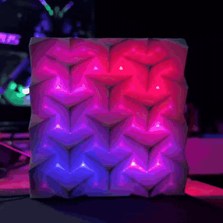
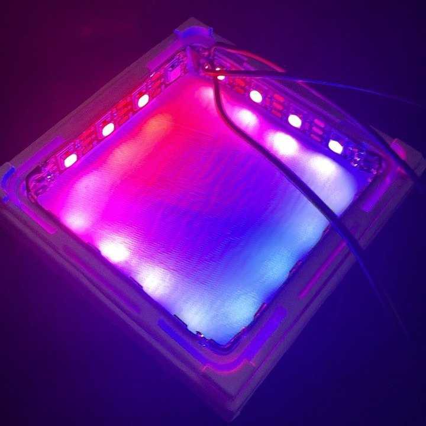
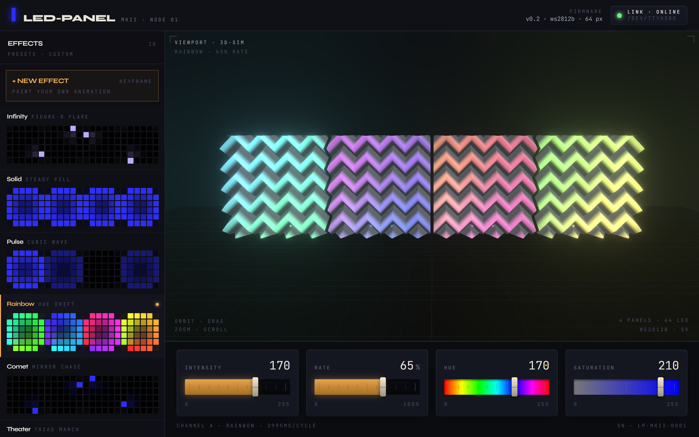
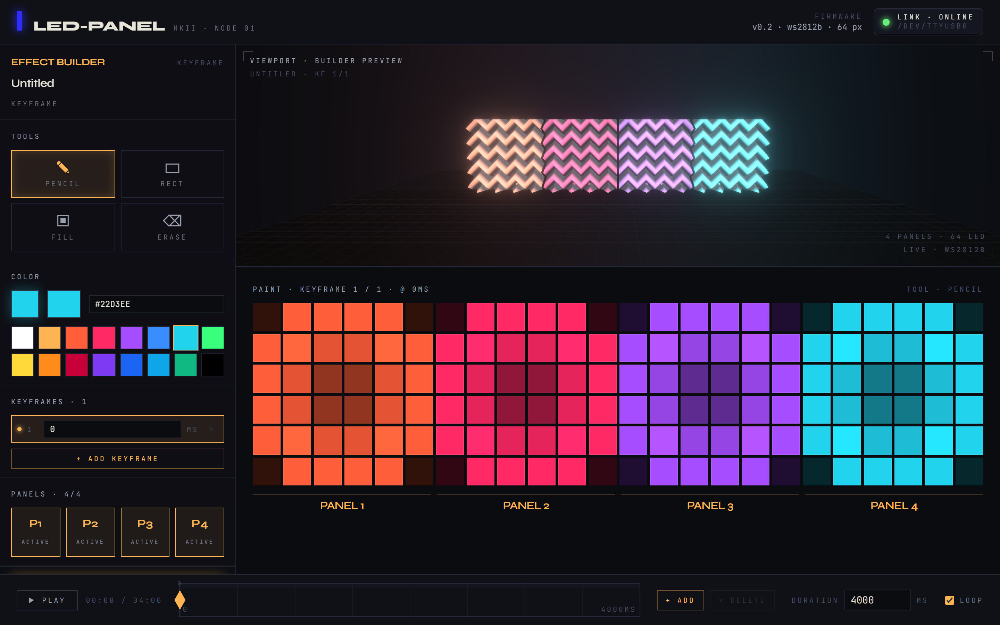

<h1 align="center">LED Panels</h1>

<p align="center">
  3D-printed wall panels lit from behind by WS2812B LEDs,<br>
  driven by an ESP8266 and controlled from a browser dashboard with a live 3D preview.
</p>

<p align="center">
   ·
   ·
   ·
   ·
  
</p>

---

<p align="center">
  
  
</p>

<p align="center">
  
</p>

## What it is

Each panel is a 3D-printed square with a chevron surface. A strip of 16
WS2812B LEDs runs around the inner frame on the back and lights the chevrons
from behind. Firmware and dashboard drive up to four panels, 64 LEDs in total.

The panel itself is not my design. It is
[3D Modular Wall Panelling, customisable & LED ready](https://makerworld.com/en/models/2015342-3d-modular-wall-panelling-customisable-led-ready)
by J3Dee on MakerWorld. Its license does not allow redistributing the files,
so the model is not in this repo (see [Panel model](#panel-model)).

The first version ran WLED, but the Wi-Fi where the panels hang is too weak to
be reliable. So the ESP8266 now has Wi-Fi switched off entirely and takes
commands over USB serial instead. A PC next to the panels holds the USB
connection, and a Raspberry Pi serves the dashboard on the local network.

## How it fits together

```
Browser (dashboard, 3D preview)
   │  HTTP  /api/*
   ▼
Raspberry Pi: dashboard/server   FastAPI, serves the built frontend, always on
   │  HTTP  :8765
   ▼
PC: bridge                       FastAPI + pyserial, finds the FTDI port via udev
   │  USB serial, 115200 baud, one "key:value" command per line
   ▼
Wemos D1 mini: led_panel.ino     FastLED, one data pin per panel
   │
   ▼
4 × 16 WS2812B
```

The Pi runs around the clock, the PC comes and goes. The dashboard shows the
link state in the top right corner and keeps working (preview only) while the
bridge is offline.

## Parts

| Folder | What it does |
|---|---|
| [`led_panel/`](led_panel/led_panel.ino) | Firmware. Ten built-in effects (infinity, solid, pulse, rainbow, comet, theater, fire, sparkle, wipe, breathe), a non-blocking line parser on serial, and a `frame:` command that takes raw RGB for all 64 LEDs. |
| [`bridge/`](bridge/bridge.py) | Runs on the PC the D1 mini is plugged into. Looks up the FTDI adapter by USB vendor/product ID, because `/dev/ttyUSBx` numbering changes between boots, and reconnects when the cable is pulled. |
| [`dashboard/server/`](dashboard/server/server.py) | Runs on the Pi. Serves the frontend and forwards `/api/*` to the bridge. |
| [`dashboard/web/`](dashboard/web/src) | React + Three.js. Builds the panels in 3D, places virtual LEDs where the real ones sit and renders every effect in the browser with the same math as the firmware. |

## Serial protocol

Plain text, one command per line:

```
mode:rainbow
bri:150          brightness 0..255
speed:3000       period of one cycle in ms
hue:170          0..255, FastLED-style
sat:210          0..255
frame:<384 hex>  64 LEDs × RGB, overrides the current mode for 250 ms
ping             answers "pong"
```

The built-in modes run on the chip, so the panels keep animating with no host
attached. Custom effects only exist in the browser: while one is selected, the
dashboard streams it with `frame:` at 20 fps. If the stream stops, the firmware
falls back to the last built-in mode after 250 ms.

## Effect builder

<p align="center">
  
</p>

Custom effects are drawn per keyframe on a 6 × 6 grid per panel (pencil, rect,
fill, erase). The grid maps onto the 16 LEDs of each frame, colors are
interpolated between keyframes, and the result plays in the 3D preview and on
the panels at the same time. Effects are stored in the browser's localStorage.
Effects written as code go into
[`dashboard/web/src/effects/custom.ts`](dashboard/web/src/effects/custom.ts).

## Hardware notes

- **Data pins:** D1 (GPIO5), D2 (GPIO4), D5 (GPIO14), D6 (GPIO12). GPIO0, 2 and 15
  are boot strapping pins on the ESP8266 and stay free.
- **Power:** bench supply at exactly 5.0 V, wired in a star to every panel. Daisy
  chaining the panels was the first plan, but the solder joints between them
  broke off, and parallel wiring has been stable since.
- **Common ground** between the supply and the D1 mini, otherwise the data line
  has no reference.
- **Current limit:** full white on 64 LEDs pulls about 3.8 A.
  `FastLED.setMaxPowerInVoltsAndMilliamps(5, 2500)` caps it in software.
- **Wi-Fi off** (`WiFi.mode(WIFI_OFF)`) gives the FastLED bit-banging fewer
  interrupts to deal with.

## Running it

Firmware (arduino-cli, ESP8266 core 3.1.2, FastLED 3.10):

```bash
cd led_panel
arduino-cli compile --fqbn esp8266:esp8266:d1_mini .
arduino-cli upload -p /dev/ttyUSB0 --fqbn esp8266:esp8266:d1_mini .
```

Bridge on the PC:

```bash
cd bridge
python -m venv .venv && .venv/bin/pip install -r requirements.txt
.venv/bin/python bridge.py            # listens on :8765
```

Dashboard on the Pi (or the same machine):

```bash
cd dashboard/web && npm ci && npm run build
cd ../server
python -m venv .venv && .venv/bin/pip install -r requirements.txt
LED_BRIDGE_URL=http://<pc>:8765 .venv/bin/python server.py   # serves on :8787
```

For frontend work, `npm run dev` in `dashboard/web` proxies `/api` to
`LED_DASHBOARD_URL` (default `http://127.0.0.1:8787`). Example systemd units for
both services are in the `systemd/` folders.

## Panel model

Without a model file the 3D preview generates a chevron relief with the same
footprint (100 × 100 mm), which is what the screenshots above show. To preview
the real panel, download the STL from
[MakerWorld](https://makerworld.com/en/models/2015342-3d-modular-wall-panelling-customisable-led-ready) and save it as
`dashboard/web/public/square.stl` before `npm run build`. The dashboard picks
it up automatically, and `*.stl` is in `.gitignore`.

## License

MIT
